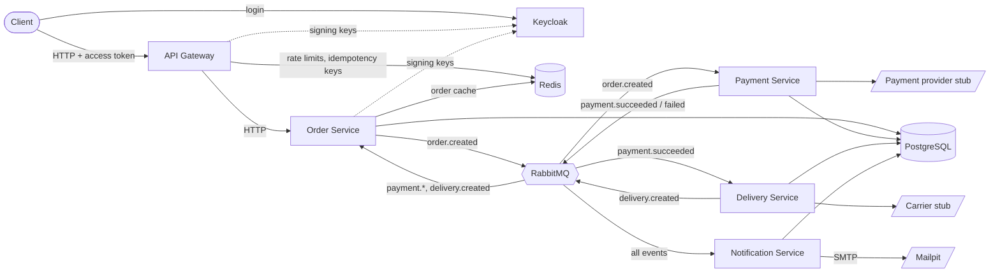
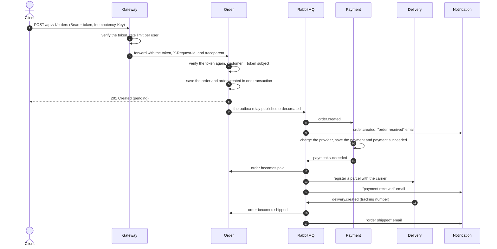

# OrderFlow

[](https://github.com/elita001/order-microservices/actions/workflows/ci.yml)


An order processing system of five Go microservices, built as a production-style portfolio
project: event-driven, fault-tolerant, and observable end to end. One `make up` starts the
whole system with its infrastructure and monitoring.

## Highlights

- **Authentication with zero trust.** OAuth 2.0 / OpenID Connect with Keycloak: the gateway
  and each service verify the access token themselves; customers see only their own orders.
- **Transactional outbox.** Business data and events are committed in one transaction; a
  relay publishes them with publisher confirms, so an event exists if and only if the change does.
- **Idempotency everywhere.** `Idempotency-Key` in the gateway (Redis) backed by a unique key
  in the database; consumers are idempotent by business keys, so at-least-once delivery
  never charges, ships, or emails twice.
- **Failure handling.** Retries with backoff through retry queues, dead letter queues with an
  inspect/replay tool, circuit breakers, fail-open Redis, consumers that pause while their
  database is down, and `503` instead of `500` for outages.
- **Cache-aside without stale writes.** Versioned entries and a Lua compare-and-set close the
  classic invalidation race; `singleflight` prevents stampedes.
- **End-to-end correlation.** One request ID and one OpenTelemetry trace follow an order across
  HTTP and RabbitMQ, through the outbox, to every service's logs and spans.
- **Observability as code.** Prometheus metrics and alert rules, Grafana dashboards generated
  with the Grafana Foundation SDK, logs in Loki, traces in Tempo, errors in GlitchTip.
- **Tested against real dependencies.** Unit tests, integration tests with testcontainers
  (PostgreSQL, RabbitMQ), golangci-lint, and GitHub Actions CI.

**Stack:** Go 1.27 · PostgreSQL 16 · RabbitMQ 4 (quorum queues) · Redis 7 · Keycloak 26 · Docker Compose ·
Prometheus · Grafana · Loki · Tempo · Grafana Alloy · OpenTelemetry · GlitchTip (Sentry SDK)

## Architecture



| Service              | Responsibility |
|----------------------|----------------|
| API Gateway          | the single entry point: request IDs, rate limiting, idempotency, timeouts |
| Order Service        | creates, retrieves, and lists orders; tracks their status from events; caches orders in Redis |
| Payment Service      | charges orders through a payment provider stub, publishes the result |
| Delivery Service     | hands paid orders over to a carrier stub, publishes the tracking number |
| Notification Service | emails customers about every order step (Mailpit in development) |

The life of an order:



Order statuses: `pending` → `paid` → `shipped`, or `pending` → `payment_failed`.

Services share one PostgreSQL database, but each owns its tables and migrations and never
reads another service's tables: they communicate only through APIs and events.

## Running

```bash
make up
```

On the first run `make up` copies `.env.example` to `.env`. Edit `.env` to change
passwords, host ports (e.g., if `5432` is already taken), or the payment stub behavior;
it is ignored by git. Running `docker compose` directly without `.env` fails with a hint
to create it.

Configuration follows the 12-factor approach: services read settings only from
environment variables and contain no secrets or credentials. `.env` is for local
development only; in production, values come from the platform (Kubernetes Secrets,
Vault, CI/CD variables).

Clients use the API gateway at http://localhost:8080. The services' own ports
(8081–8084) are published for debugging only.

Management UIs:

- Keycloak (identity provider; admin / `KEYCLOAK_ADMIN_PASSWORD`): http://localhost:8180
- RabbitMQ: http://localhost:15672 (credentials `RABBITMQ_USER` / `RABBITMQ_PASSWORD` from `.env`, `app` / `app` by default)
- Mailpit (all emails sent by the system): http://localhost:8025
- Grafana (dashboards, no login needed to view; admin / `GRAFANA_ADMIN_PASSWORD`): http://localhost:3000
- Prometheus (metrics, alerts): http://localhost:9090
- GlitchTip (errors; `GLITCHTIP_ADMIN_EMAIL` / `GLITCHTIP_ADMIN_PASSWORD` from `.env`): http://localhost:8000
- Alloy (telemetry pipeline graph): http://localhost:12345

Useful commands:

| Command         | Description                                          |
|-----------------|------------------------------------------------------|
| `make logs`     | follow the logs of all application services          |
| `make orders`   | latest orders with their payment, shipment, and sent emails |
| `make outbox`   | latest outbox messages of all services and their delivery state |
| `make token user=alice` | print an access token of a test user |
| `make test`     | unit tests with the race detector                    |
| `make test-integration` | integration tests with real PostgreSQL and RabbitMQ (needs Docker) |
| `make lint`     | golangci-lint, the same version as in CI             |
| `make check`    | everything CI checks: lint, unit and integration tests |
| `make dashboards` | regenerate the Grafana dashboards after editing `cmd/dashboards` |
| `make dlq-list queue=payment-service`   | show dead-lettered messages with their errors |
| `make dlq-replay queue=payment-service` | move dead-lettered messages back for processing |

## Example requests

Every API call needs an access token. Get one for a test user (valid for 15 minutes):

```bash
TOKEN=$(make -s token user=alice)
```

```bash
curl -s -X POST 'localhost:8080/api/v1/orders' \
  -H "Authorization: Bearer $TOKEN" \
  -H 'Content-Type: application/json' \
  -H "Idempotency-Key: $(uuidgen)" \
  -d '{
    "currency": "RUB",
    "items": [{"product_id": "book-42", "quantity": 2, "price": 59900}]
  }'
```

The order belongs to the authenticated user: there is no `customer_id` in the request.

The order is created as `pending`. A second or two later it becomes `shipped` or
`payment_failed` (by default the payment stub declines ~20% of payments), and the
emails appear in Mailpit:

```bash
curl -s 'localhost:8080/api/v1/orders/<id>' -H "Authorization: Bearer $TOKEN"
```

List your orders (`support` may add `customer_id=<id>` to see another customer's orders):

```bash
curl -s 'localhost:8080/api/v1/orders?limit=20&offset=0' -H "Authorization: Bearer $TOKEN"
```

Amounts are stored in the currency's smallest units (kopecks): `59900` = RUB 599.00.

## Authentication and authorization

Clients log in to **Keycloak** (OAuth 2.0 / OpenID Connect) and call the API with the access
token (a JWT signed by Keycloak). The realm, its roles, client, and test users are imported
from `deploy/keycloak/orderflow-realm.json` on startup.

| User | Password | Role | May |
|------|----------|------|-----|
| `alice`, `bob` | same as the user name | `customer` | place orders, see and list their own orders |
| `support` | `support` | `support` | see and list the orders of every customer |

**Zero trust.** The gateway verifies the token and rejects bad requests early (`401`). Order
Service verifies the same token again and takes the customer from its `sub` claim. It never
trusts identity headers such as `X-User-Id`: its port can be reached directly (it is even
published for debugging), and such a header could be set by anyone. A verifier checks the
signature (keys from Keycloak's JWKS, cached and refreshed on key rotation), the issuer, the
audience (`orderflow-api`, so a token issued for another API is rejected), and the expiry.

**Authorization rules** live in the use cases, not in the HTTP layer:

- the customer of a new order is the token's user; a `customer_id` in the body is rejected;
- another customer's order is reported as `404`, not `403`, so its existence is not revealed;
- listing another customer's orders is `403` for customers and allowed for `support`.

Identity also scopes the gateway's protections: **rate limits are per user** (users behind one
NAT do not share a limit, and changing IPs does not bypass it), and **idempotency keys are per
customer**, in Redis and in the database (`UNIQUE (customer_id, idempotency_key)`): another
customer with the same key and body gets their own order, never someone else's response.

**Issuer and keys.** Tokens are issued by the public URL `http://localhost:8180/realms/orderflow`
(`OIDC_ISSUER`), while the services fetch the keys over the internal network from
`http://keycloak:8080/...` (`OIDC_JWKS_URL`). `KC_HOSTNAME` makes Keycloak put the public
issuer into every token, however it was reached.

For local development the `orderflow-cli` client allows the password grant, so tokens can be
fetched with curl (`make token`). A browser application would use the authorization code
flow with PKCE instead, and service-to-service calls would use client credentials.

## API Gateway

The gateway is the single entry point for clients. It contains no business logic and
applies the edge concerns to every request:

- **Request ID.** The gateway always generates its own `X-Request-Id` (a UUID), returns it
  in the response (a client quotes it to support), and forwards it to the services. A
  client-supplied ID could collide with another client's or be chosen to mix into someone
  else's logs, so it is only logged as `client_request_id` next to ours.
- **Tracing at the edge.** The gateway starts a new trace for every request: a
  `traceparent` from the internet is only linked, never continued. Otherwise a client could
  attach requests to someone else's trace or force its traces to be sampled.
- **Rate limiting** per client IP in Redis (GCRA, exact across gateway replicas):
  `RATE_LIMIT_WRITE_*` for `POST`, `RATE_LIMIT_READ_*` for `GET`. Over the limit the
  client gets `429` with `Retry-After`.
- **Idempotency.** A client can safely retry `POST /orders` (e.g., after a timeout) with
  the same `Idempotency-Key` header, and only one order is created:

  | Situation | Response |
  |---|---|
  | First request | goes to Order Service; the response is stored in Redis for `IDEMPOTENCY_TTL` |
  | Repeat after it | the stored response with `Idempotent-Replayed: true` |
  | Repeat while the first is in progress | `409` with `Retry-After: 1` |
  | Same key, different body | `422 idempotency_key_reused` |
  | First request failed with 5xx | not stored, the client can retry |

- **Timeouts.** An upstream that cannot be reached gets `502`, one that does not respond
  within `UPSTREAM_TIMEOUT` gets `504`; the client never waits indefinitely.

**Redis is an accelerator, not a source of truth.** Every Redis call is bounded by
`REDIS_OPERATION_TIMEOUT` (a hanging Redis is worse than a failed one), and on errors the
gateway fails open: requests pass without rate limiting, and idempotency is enforced by
Order Service itself, which stores the key in `orders.idempotency_key` with a unique
constraint and replays the existing order. The two layers complement each other: Redis
answers repeats fast and keeps them away from the services, and the database guarantees
correctness when Redis is down or its entry has expired.

## Order cache

`GET /orders/{id}` uses **cache-aside** in Order Service, the owner of the data:
read Redis → on a miss read PostgreSQL and put the order into Redis. The cache is a
decorator around the repository ([`internal/order/adapter/cache`](internal/order/adapter/cache)),
so the use cases do not know about it.

- **Invalidation.** Every status change (`paid`, `payment_failed`, `shipped`) invalidates
  the entry right after the database update; `CACHE_TTL` (with 10% jitter, so entries do
  not expire all at once) only bounds staleness if an invalidation is lost.
- **No stale writes.** The classic cache-aside race: a reader loads the order, the status
  changes and the entry is invalidated, then the reader writes the old order back. Each
  entry stores its version (`updated_at`), and a Lua script writes only newer versions;
  invalidation leaves a tombstone with the new version instead of deleting the key, so the
  late write of the old version is rejected.
- **No stampede.** Concurrent misses for the same order share one database query
  (`singleflight`).
- **Fail-open.** Redis errors are logged and the database is used; every Redis call is
  bounded by `REDIS_OPERATION_TIMEOUT`.
- Lists (`GET /orders`) are not cached: they change with every new order, and
  invalidating them correctly costs more than the query, which uses an index.

## Events

| Event               | Producer | Consumers | Payload contract                                 |
|---------------------|----------|-----------|--------------------------------------------------|
| `order.created`     | order    | payment, notification | [`pkg/events/order.go`](pkg/events/order.go) |
| `payment.succeeded` | payment  | order, delivery, notification | [`pkg/events/payment.go`](pkg/events/payment.go) |
| `payment.failed`    | payment  | order, notification | [`pkg/events/payment.go`](pkg/events/payment.go) |
| `delivery.created`  | delivery | order, notification | [`pkg/events/delivery.go`](pkg/events/delivery.go) |

All events go through the `orderflow.events` topic exchange; the event type is the
routing key. Each consuming service has its own durable quorum queue (`order-service`,
`payment-service`, `delivery-service`, `notification-service`) and declares the exchange, queue, and bindings on connect, so the
services can start in any order and messages wait in the queue while a consumer is down.

### Transactional outbox

Services never publish to RabbitMQ from business code. Instead:

1. The business data and the event row in the service's outbox table (`order_outbox`,
   `payment_outbox`, `delivery_outbox`) are written in **one database transaction**, so the event exists
   if and only if the data change exists.
2. A background **outbox relay** (runs inside each service) locks a batch of unpublished
   rows with `FOR UPDATE SKIP LOCKED`, publishes them, waits for **publisher confirms**,
   and only then sets `published_at`.
3. If RabbitMQ is down, the services keep working. The relay records `attempts` and
   `last_error`, retries with exponential backoff, and reconnects automatically.
4. Published rows are deleted after `OUTBOX_RETENTION`.

### Idempotent consumers

Delivery is **at-least-once**: an event can be delivered twice (e.g., the process crashes
after the broker confirm but before `published_at` is saved), so every handler is idempotent:

- **Payment Service** keeps one payment per order (`UNIQUE (order_id)`). A pending payment
  is created *before* calling the provider, and its ID is the provider's idempotency key:
  if processing is interrupted and the message is redelivered, the provider returns the
  same result instead of charging twice. A completed payment is never charged again.
- **Delivery Service** works the same way: one shipment per order, and the shipment ID is
  the carrier's idempotency key.
- **Order Service** changes the status only from the expected statuses
  (`UPDATE ... WHERE status = ANY(...)`), so repeated or late events change nothing.
  Events from different services can arrive out of order (e.g., `delivery.created` before
  `payment.succeeded`); a shipment implies payment, so `pending` → `shipped` is allowed
  and the late payment event is ignored.
- **Notification Service** sends at most one email of each kind per order
  (`UNIQUE (kind, order_id)`). The row is inserted and the email is sent in one
  transaction: a concurrent duplicate waits on the unique index, and a failed send rolls
  the row back so that a retry sends again. A crash right after sending can still cause
  a rare duplicate email: SMTP offers no stronger guarantee.


## Reliability

The goal: a message can be delayed, but it is never lost silently. It is either processed
or parked in a dead letter queue, and the failure is visible.

### Retries with backoff and dead letter queues

Every consuming service has a queue, retry queues, and a dead letter queue (DLQ):

```
payment-service ──failure──▶ payment-service.retry.<delay> ──TTL──▶ payment-service
       │                     (1s, 5s, 30s, 2m, 10m; no consumers)
       └──permanent error or retries exhausted──▶ payment-service.dlq
```

- **Transient errors** (a provider timeout, an open circuit breaker): the consumer publishes
  a copy to the retry queue of the next delay and acks the original; when the TTL expires,
  RabbitMQ dead-letters it back. The handler is not blocked, and the queue is not flooded
  with immediate redeliveries.
- **Permanent errors** (malformed JSON, invalid data) and **exhausted retries**: the message
  goes to the DLQ with `x-error`, `x-retry-count`, `x-original-queue`, and `x-failed-at`.
- **Panics** in handlers are recovered and treated as transient errors.
- **Safety net:** the queue itself dead-letters to the DLQ after 20 redeliveries (e.g., if
  the process crashes on a message every time), with at-least-once dead-lettering.

Working with the DLQ, as in production: alert when it is not empty (step 8), find the cause
by `message_id` in the logs, fix it, and replay. Handlers are idempotent, so replaying is safe:

```bash
make dlq-list queue=payment-service     # what failed and why
make dlq-replay queue=payment-service   # back to processing with a fresh retry budget
```

### Circuit breakers

After 5 consecutive failures a breaker opens: calls fail immediately instead of waiting for
timeouts, and after `OPEN_TIMEOUT` a trial call checks whether the dependency recovered.

| Breaker | Protects | While open |
|---------|----------|------------|
| Redis (gateway, order cache) | every request from waiting `REDIS_OPERATION_TIMEOUT` | rate limiting and the cache are skipped (fail-open); requests take ~2ms instead of ~900ms |
| Payment provider | the provider from a flood of calls, consumers from timeouts | payments fail fast and are retried with backoff |
| Carrier | the same for shipments | shipments are retried with backoff |

Only infrastructure errors count: a declined payment or a Redis error reply (`redis.Nil`)
means the dependency works. Set `PAYMENT_STUB_ERROR_RATE=1` to see the payment breaker open.

### Database outages

- Consumers check the database every `CONSUMER_HEALTH_INTERVAL` and **pause** while it is
  down: messages wait in the queue instead of failing and using up their retries.
- HTTP requests get `503` with `Retry-After` instead of `500`: it is a temporary condition,
  not a bug. Every request has a deadline (`REQUEST_TIMEOUT`, 3s) shorter than the gateway's
  upstream timeout (5s), so the service answers before the gateway gives up.
- Readiness (`/readyz`) fails, so an orchestrator stops routing traffic, but liveness
  (`/healthz`) does not, so it does not restart the service in a loop.

### Out-of-order events

Notification Service sends the "order shipped" email only after "payment received": if
`delivery.created` arrives first, the handler returns a transient error and the event is
retried with backoff until the payment event has been handled.

### Upgrading an existing environment

RabbitMQ refuses to redeclare an existing queue with different arguments. If a service logs
"a queue exists with different arguments", delete the old queues (development only, their
messages are lost) and the services will recreate them:

```bash
make rabbitmq-reset-queues
```

## Observability: metrics, dashboards, alerts

Every service exposes Prometheus metrics at `/metrics` on its internal port. The gateway
serves them on a separate port (`METRICS_ADDR`, 9080), because its main port is public.
Prometheus scrapes the services and RabbitMQ's built-in exporter every 10 seconds.

| Group | Metrics |
|-------|---------|
| HTTP (RED) | `http_requests_total{method,route,status}`, `http_request_duration_seconds`, `http_requests_in_flight`. `route` is the chi pattern (`/api/v1/orders/{id}`), not the path: with raw paths every order ID would create new time series |
| Gateway | `gateway_rate_limit_decisions_total{policy,decision}`, `gateway_idempotency_requests_total{result}` |
| Consumers | `messaging_consumed_messages_total{queue,event,result}` (ack, retry, dead_letter, requeue), `messaging_processing_duration_seconds`, `messaging_consumer_paused` |
| Outbox | `outbox_published_messages_total`, `outbox_publish_errors_total`, `outbox_pending_messages`, `outbox_oldest_pending_age_seconds` (how late events are) |
| Resilience | `circuit_breaker_state{name}` (0 closed, 1 half-open, 2 open), `order_cache_requests_total{result}` |
| Business | `orders_created_total`, `order_status_changes_total`, `payments_total{status,reason}`, `payment_amount_minor_units_total`, `shipments_registered_total`, `notifications_sent_total` |
| RabbitMQ | queue depth per queue, including retry queues and DLQs (`rabbitmq_detailed_queue_messages`) |

Business metrics are recorded through a `Metrics` port of each application service and a
Prometheus adapter, so the use cases do not depend on the metrics library.

**Dashboards are code.** Grafana provisions the data source and three dashboards from
`deploy/grafana` on startup:

- **Business:** orders, payment success rate, revenue per currency, decline reasons,
  shipments by carrier, emails sent.
- **Services:** health of every service, request rate, 5xx ratio, p95 latency, gateway
  latency per route, rate limiter and idempotency decisions, cache hit ratio, circuit breakers.
- **Messaging:** dead-lettered messages, outbox lag, paused consumers, retries, consumer
  throughput and latency, queue depth.

The JSON files are generated by `cmd/dashboards` with the
[Grafana Foundation SDK](https://github.com/grafana/grafana-foundation-sdk): typed Go builders
instead of hand-written JSON. Edit the panels there and run `make dashboards`; CI fails if the
committed JSON differs from the generator's output. Counts over a time range use `increase()`, which extrapolates, so they are
approximate; exact numbers come from the database. Prometheus runs with
`created-timestamp-zero-ingestion`, so counters that appear with a non-zero value (e.g., right
after a service starts) are not undercounted.

**Alerts** (`deploy/prometheus/alerts.yml`, visible at http://localhost:9090/alerts):

| Alert | Fires when |
|-------|------------|
| `ServiceDown` | a service cannot be scraped for 1 minute |
| `HighErrorRate` | more than 5% of a service's responses are 5xx for 5 minutes, with at least 50 requests per 5 minutes |
| `SlowRequests` | p95 latency of a service is above 1s for 10 minutes, with at least 50 requests per 5 minutes |
| `DeadLetterQueueNotEmpty` | a DLQ has messages; the description contains the `make dlq-list` command |
| `OutboxLagging` | the oldest unpublished event is older than 60s (is RabbitMQ down?) |
| `ConsumerPaused` | a consumer has been paused for 2 minutes (its database is down) |
| `CircuitBreakerOpen` | a breaker has been open for 1 minute |
| `HighPaymentDeclineRate` | more than half of the payments are declined for 10 minutes, with at least 20 payments per 15 minutes |

Ratio alerts require a minimum volume: with two requests, one error is already 50%, which
says nothing about the service. The rules have unit tests (`deploy/prometheus/alerts_test.yml`,
`make test-alerts`, also run in CI): synthetic time series check, for example, that 50% errors
at 2 requests per minute do not alert, while 10% errors at 100 requests per minute do.

Delivering alerts to Slack or email needs Alertmanager, which is not part of the local setup.

## Logs, traces, and errors

One business flow (an order from `POST /orders` to the "shipped" email) crosses five
services and three message hops. Three things tie it together:

- **Request ID.** The gateway generates `X-Request-Id` and returns it to the client; every
  service puts it into its logs (`request_id`).
- **Trace context.** OpenTelemetry spans for HTTP, SQL (pgx), Redis, message publishing and
  processing, and external calls (payment provider, carrier, SMTP) form one trace.
- **Propagation across the async boundary.** When an event is stored in the outbox, the
  current `traceparent` and request ID are saved in the `headers` column. The relay
  publishes them as AMQP headers, and the consumer continues the same trace and request ID,
  so the events it produces carry them on to the next service.

```
gateway ──HTTP traceparent──▶ order ──outbox headers──▶ relay ──AMQP headers──▶ payment ──▶ ...
```

**Logs.** Services write JSON logs (`log/slog`) to stdout. Grafana Alloy reads them from
Docker and sends them to Loki. Alloy runs as an unprivileged user and has no access to the
Docker socket, which equals root on the host even when mounted read-only: it reads container
lists and logs through `docker-socket-proxy`, which allows only those read-only API calls
and is reachable only from an internal network. `service` and `level` are labels; `request_id` and `trace_id`
are structured metadata: they are unique per request, and as labels they would create a
stream per request. Every record written with a context (`InfoContext`) gets `request_id`,
`trace_id`, and `span_id` automatically.

```logql
{service=~".+"} | request_id="<id>"
```

The **Logs** dashboard has a "Request ID" filter that shows one order's whole flow; a
`trace_id` in a record links to its trace.

**Traces.** Services export spans over OTLP to Alloy, which forwards them to Tempo. In
Grafana (Explore → Tempo) a trace shows the whole order: e.g., ~1s between the order commit
and `order.created publish` is the outbox polling interval, and `payment_provider.charge`
shows how long the provider took. Each span links to its logs, and Tempo builds the
**service map** (Explore → Tempo → Service Graph) from the spans.

**Errors.** Panics, unexpected 500s, and messages moved to a dead letter queue are reported
with the official `sentry-go` SDK to GlitchTip, a lightweight Sentry-compatible server.
Each report is tagged with `request_id`, `trace_id`, and, for messages, the queue, event,
and `message_id`. Expected conditions (validation errors, an unavailable database, retried
messages) are not reported: metrics and alerts cover them. On first start, `glitchtip-init`
creates the admin user and the project with the DSN key from `.env`, so nothing has to be
set up by hand. Set `SENTRY_DSN` to send errors to sentry.io instead.

Try it:

```bash
curl -s -i -X POST localhost:8080/api/v1/orders -H 'Content-Type: application/json' \
  -H "Authorization: Bearer $(make -s token user=alice)" \
  -d '{"currency":"RUB","items":[{"product_id":"book-42","quantity":1,"price":59900}]}' \
  | grep -i x-request-id
```

Then open the Logs dashboard with that request ID, and the `trace_id` link of any record.

### External service stubs

| Stub | Behavior |
|------|----------|
| Payment provider | random delay; declines a `PAYMENT_STUB_FAILURE_RATE` share of payments (`insufficient_funds`, `card_declined`, `card_expired`) — a business outcome, published as `payment.failed` |
| Carrier | random delay; fails a `DELIVERY_STUB_ERROR_RATE` share of calls with a technical error — the consumer retries until it succeeds |
| Customer directory | returns `customer-<first 8 chars of customer ID>@example.com` |
| Email | real SMTP to [Mailpit](https://mailpit.axllent.org), which catches every email |

Like real providers, the payment and carrier stubs are idempotent: the outcome (decline,
tracking number) is derived from the idempotency key, so a retry gets the same result.

## Testing and quality

| Level | What it covers | Run |
|-------|----------------|-----|
| Unit tests | authorization rules, token verification against a fake identity provider (real RSA signatures: expired, foreign key, wrong issuer or audience), use cases with fakes, HTTP and messaging adapters, the gateway with a real HTTP upstream and an in-memory Redis (miniredis), the cache and its Lua script, circuit breakers, header propagation | `make test` |
| Integration tests | real PostgreSQL and RabbitMQ in containers (testcontainers): SQL and constraints, concurrent duplicates on unique indexes (one payment, one email), and the full path outbox → relay → RabbitMQ → consumer → retry queue → DLQ, keeping the request ID and the trace | `make test-integration` |
| Alert rules | `promtool test rules`: which alerts fire on synthetic series, with labels and annotations | `make test-alerts` |
| Static analysis | golangci-lint: the standard linters plus error wrapping, closed rows and bodies, contexts in requests, gosec | `make lint` |

Integration tests carry the `integration` build tag, so `go test ./...` stays fast and needs
no Docker. They start the containers once per package and isolate tests by random IDs.

**CI** (GitHub Actions, `.github/workflows/ci.yml`) runs on every push and pull request:

| Job | Checks |
|-----|--------|
| `lint` | golangci-lint |
| `test` | `go vet`, unit tests with the race detector |
| `integration` | integration tests (Docker is available on GitHub runners) |
| `dashboards` | the committed dashboard JSON matches `cmd/dashboards` |
| `config` | Docker Compose file, Prometheus config, alert rule unit tests (`promtool`), Alloy config |
| `build` | Docker images of all five services |

## Configuration

Telemetry (all Go services):

| Variable                       | Default | Description                                         |
|--------------------------------|---------|-----------------------------------------------------|
| `OTEL_EXPORTER_OTLP_ENDPOINT`  | — (tracing off) | OTLP/HTTP collector, `http://alloy:4318`    |
| `OTEL_TRACES_SAMPLER_RATIO`    | `1`     | share of traces kept (the caller's decision wins)   |
| `SENTRY_DSN`                   | — (reporting off) | GlitchTip or Sentry DSN                   |
| `SENTRY_ENVIRONMENT`, `SENTRY_RELEASE` | `development`, — | tags of error reports              |

Authentication (gateway and Order Service):

| Variable         | Default | Description |
|------------------|---------|-------------|
| `OIDC_ISSUER`    | — (required) | expected `iss` of access tokens: the public realm URL |
| `OIDC_JWKS_URL`  | — (required) | where the signing keys are fetched (internal URL) |
| `OIDC_AUDIENCE`  | `orderflow-api` | required `aud` of access tokens |

API gateway:

| Variable                    | Default  | Description                                    |
|-----------------------------|----------|------------------------------------------------|
| `HTTP_ADDR`                 | `:8080`  | listen address                                 |
| `ORDER_SERVICE_URL`         | — (required) | Order Service base URL                     |
| `REDIS_URL`                 | — (required) | `redis://:password@host:6379/0`            |
| `REDIS_OPERATION_TIMEOUT`   | `300ms`  | one Redis call including dialing and retries   |
| `REDIS_BREAKER_FAILURES`, `REDIS_BREAKER_OPEN_TIMEOUT` | `5`, `30s` | circuit breaker of Redis (also in Order Service) |
| `REDIS_DIAL_TIMEOUT`, `REDIS_READ_TIMEOUT`, `REDIS_WRITE_TIMEOUT` | `500ms`, `200ms`, `200ms` | Redis client timeouts |
| `UPSTREAM_TIMEOUT`          | `5s`     | whole upstream request                         |
| `UPSTREAM_DIAL_TIMEOUT`     | `2s`     | connecting to the upstream                     |
| `RATE_LIMIT_READ_RPS`, `RATE_LIMIT_READ_BURST`   | `50`, `100` | GET requests per second per client IP and burst |
| `RATE_LIMIT_WRITE_RPS`, `RATE_LIMIT_WRITE_BURST` | `5`, `10`   | POST requests per second per client IP and burst |
| `IDEMPOTENCY_TTL`           | `24h`    | how long a response is replayed                |
| `IDEMPOTENCY_LOCK_TTL`      | `30s`    | lock of a request in progress (crash safety)   |
| `LOG_LEVEL`, `SHUTDOWN_TIMEOUT` | `info`, `10s` | as in the services                     |

Order Service cache:

| Variable                  | Default | Description                                          |
|---------------------------|---------|------------------------------------------------------|
| `REDIS_URL`               | — (required) | `redis://:password@host:6379/0`                 |
| `REDIS_OPERATION_TIMEOUT` | `300ms` | one Redis call; on timeout the database is used      |
| `CACHE_TTL`               | `5m`    | lifetime of a cached order (+ up to 10% jitter)      |
| `CACHE_LOAD_TIMEOUT`      | `5s`    | a database load shared by concurrent misses          |
| `REQUEST_TIMEOUT`         | `3s`    | deadline of every API request (shorter than the gateway's) |

Common variables of the services:

| Variable                    | Default            | Description                              |
|-----------------------------|--------------------|------------------------------------------|
| `HTTP_ADDR`                 | `:8081`–`:8084`    | listen address (order, payment, delivery, notification) |
| `POSTGRES_DSN`              | — (required)       | PostgreSQL connection string             |
| `RABBITMQ_URL`              | — (required)       | AMQP connection string                   |
| `RABBITMQ_EXCHANGE`         | `orderflow.events` | topic exchange for integration events    |
| `RABBITMQ_QUEUE`            | `<service>-service`| queue the service consumes               |
| `LOG_LEVEL`                 | `info`             | `debug`, `info`, `warn`, `error`         |
| `SHUTDOWN_TIMEOUT`          | `10s`              | time for in-flight requests on shutdown  |
| `OUTBOX_BATCH_SIZE`         | `100`              | messages per relay transaction           |
| `OUTBOX_POLL_INTERVAL`      | `1s`               | pause when the outbox is empty           |
| `OUTBOX_MAX_BACKOFF`        | `30s`              | maximum pause after failures             |
| `OUTBOX_PUBLISH_TIMEOUT`    | `5s`               | per message, including broker confirm    |
| `OUTBOX_BATCH_TIMEOUT`      | `8s`               | a started batch is finished on shutdown  |
| `OUTBOX_RETENTION`          | `168h`             | how long published rows are kept         |
| `OUTBOX_CLEANUP_INTERVAL`   | `1h`               | how often old rows are deleted           |
| `CONSUMER_PREFETCH`         | `10`               | unacknowledged messages per connection   |
| `CONSUMER_CONCURRENCY`      | `4`                | messages handled in parallel             |
| `CONSUMER_HANDLER_TIMEOUT`  | `10s`              | a started handler is finished on shutdown |
| `CONSUMER_RETRY_DELAYS`     | `1s,5s,30s,2m,10m` | pauses before each retry; then the DLQ   |
| `CONSUMER_HEALTH_INTERVAL`  | `5s`               | database check; consumption pauses while it fails |
| `CONSUMER_REQUEUE_DELAY`    | `1s`               | pause before requeueing if forwarding to a retry queue fails |
| `CONSUMER_MAX_BACKOFF`      | `30s`              | maximum pause between reconnects         |

The notification service has no outbox, so the `OUTBOX_*` variables do not apply to it.

Service-specific variables:

| Service      | Variable                    | Default | Description                              |
|--------------|-----------------------------|---------|------------------------------------------|
| payment      | `PAYMENT_STUB_FAILURE_RATE` | `0.2`   | share of declined payments, 0..1         |
| payment      | `PAYMENT_STUB_ERROR_RATE`   | `0`     | share of calls failing with a technical error, 0..1 |
| payment      | `PROVIDER_BREAKER_FAILURES`, `PROVIDER_BREAKER_OPEN_TIMEOUT` | `5`, `30s` | circuit breaker of the payment provider |
| delivery     | `CARRIER_BREAKER_FAILURES`, `CARRIER_BREAKER_OPEN_TIMEOUT`   | `5`, `30s` | circuit breaker of the carrier |
| payment      | `PAYMENT_STUB_MIN_DELAY`    | `100ms` | minimum provider response time           |
| payment      | `PAYMENT_STUB_MAX_DELAY`    | `1s`    | maximum provider response time           |
| delivery     | `DELIVERY_STUB_ERROR_RATE`  | `0.1`   | share of carrier calls failing with a technical error |
| delivery     | `DELIVERY_STUB_MIN_DELAY`   | `100ms` | minimum carrier response time            |
| delivery     | `DELIVERY_STUB_MAX_DELAY`   | `500ms` | maximum carrier response time            |
| notification | `SMTP_HOST`, `SMTP_PORT`    | `localhost`, `1025` | SMTP server                  |
| notification | `SMTP_USERNAME`, `SMTP_PASSWORD` | — | credentials; empty disables authentication |
| notification | `SMTP_TLS`                  | `false` | require STARTTLS                         |
| notification | `SMTP_FROM`                 | `OrderFlow <noreply@orderflow.local>` | sender |
| notification | `SMTP_TIMEOUT`              | `10s`   | timeout of one SMTP session              |

## Project structure

```
cmd/<service>/                           entry points, configuration, dependency wiring
internal/gateway/                        API gateway: routing, proxy, rate limiting, idempotency
internal/<service>/domain/               business entities, domain events and errors
internal/<service>/application/          use cases and ports
internal/<service>/adapter/http/         HTTP delivery adapter
internal/<service>/adapter/messaging/    RabbitMQ delivery adapter (event handlers)
internal/<service>/adapter/postgres/     PostgreSQL persistence adapter
internal/<service>/adapter/provider/     external provider adapters: payment provider, carrier (stubs)
internal/notification/adapter/smtp/      email delivery over SMTP
internal/notification/adapter/customer/  customer directory (stub)
pkg/                                     shared infrastructure: logger, HTTP helpers, shutdown
pkg/outbox/                              transactional outbox: storing messages and the relay
pkg/rabbitmq/                            RabbitMQ connection, publisher with confirms, consumer
pkg/events/                              integration event contracts shared between services
pkg/redisclient/                         Redis client with fail-fast timeouts and a circuit breaker
pkg/auth/                                access token verification, principal in context, test identity provider
pkg/breaker/                             circuit breakers for dependencies
cmd/dlq/                                 tool to inspect and replay dead letter queues
cmd/dashboards/                          Grafana dashboards as code (Grafana Foundation SDK)
internal/testkit/                        testcontainers setup for integration tests
.github/workflows/                       CI pipeline
internal/<service>/adapter/metrics/      business metrics (Prometheus adapter of the Metrics port)
pkg/metrics/                             /metrics handler and HTTP RED middleware
deploy/prometheus/                       scrape configuration and alert rules
deploy/grafana/                          data sources and the generated dashboards
deploy/keycloak/                         realm with roles, client, and test users
deploy/loki/, deploy/tempo/              log and trace storage configuration
deploy/alloy/                            telemetry agent: container logs to Loki, OTLP traces to Tempo
deploy/glitchtip/                        bootstrap of the error tracker (admin, project, DSN key)
pkg/telemetry/                           OpenTelemetry setup and trace context propagation
pkg/requestid/, pkg/errtrack/            request ID in context, error reporting
internal/order/adapter/cache/            cache-aside decorator of the order repository
migrations/<service>/                    SQL migrations per service (golang-migrate)
```

The application layer depends on its ports and the domain, not on the HTTP, RabbitMQ,
or PostgreSQL adapters. The executable wires concrete adapters into the application service.

Create a migration: `make migrate-new service=payment name=add_refunds`.
